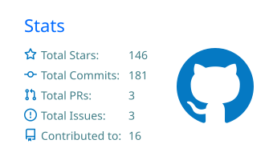
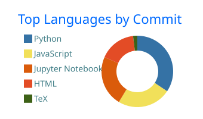

<!-- Header -->


<div align="center">

<a href="https://git.io/typing-svg">
  
</a>

<p>
  <a href="https://scholar.google.com/citations?hl=en&user=BDpLfNUAAAAJ"></a>
  <a href="https://www.linkedin.com/in/khangchris/"></a>
  <a href="mailto:nhatkhangdtp@gmail.com"></a>
  <a href="https://mbzuai.ac.ae/"></a>
  <a href="https://oisp.hcmut.edu.vn/en/"></a>
  
</p>

</div>

---

### 👋 Hi, I'm Khang — most people call me Chris.

I'm a second-year PhD student at **[MBZUAI](https://mbzuai.ac.ae/)**, where I work on **vision-language models** and **large language models**. Before that, I studied Computer Science at **[HCMUT (VNU-HCM)](https://oisp.hcmut.edu.vn/en/)**, wrapped it up in three and a half years, and went straight into the PhD without a master's in between.

What keeps me in this field is a simple question: *how do models connect what they see with what they read, and why do they get it wrong when they don't?* I also care a lot about **low-resource languages**. Some of my favorite projects have been building data and models for Vietnamese and the minority languages of Vietnam, like Bahnar, Cham, Khmer, and Tay-Nung. I like research that ends in something you can actually run, so I spend about as much time writing training loops and tooling as I do reading papers.

```yaml
currently:
  role:      2nd-year PhD Student @ MBZUAI
  born:      2003
  focus:     [Vision-Language Models, LLMs, Low-Resource NLP]
  also_into: [Data Science, Applied ML Systems]
  open_to:   research collaborations · interesting side projects · good conversations
```

---

### 🔬 Research Interests

<table>
  <tr>
    <td width="33%" valign="top">
      <b>🧠 Multimodal Learning</b><br/>
      <sub>How vision, language, and other signals can be aligned, fused, and reasoned over in a single model.</sub>
    </td>
    <td width="33%" valign="top">
      <b>💬 LLMs &amp; NLP</b><br/>
      <sub>Making language models more grounded, more efficient, and more useful when people actually rely on them.</sub>
    </td>
    <td width="33%" valign="top">
      <b>🌏 Low-Resource NLP</b><br/>
      <sub>Corpora, translation, and compact models for Vietnamese and the minority languages that big models tend to leave behind.</sub>
    </td>
  </tr>
</table>

---

### 📝 Selected Publications

<sub>Full list on <a href="https://scholar.google.com/citations?hl=en&user=BDpLfNUAAAAJ">Google Scholar</a>.</sub>

- **When Morphology Hides in Plain Sight: Breaking the Isolation in Vietnamese and Beyond**<br/>
  <sub>A.T.D. Dinh, <b>K.N.H. Vo</b>, T.T. Ta, V.C. Doan, T. Quan · <b>ACL 2026</b></sub>
- **Failing to See or Failing to Know? Attributing Errors in Vision-Language Models**<br/>
  <sub><b>K.N.H. Vo</b>, A. Vazhentsev, A. Shelmanov, T. Baldwin, et al. · arXiv 2026 · <a href="https://arxiv.org/abs/2607.04683">paper</a></sub>
- **Whispers from the Neighbors: Rethinking Caption Consensus as Inference-Time Evidence for Vision-Language Retrieval**<br/>
  <sub><b>K.N.H. Vo</b>, B. Shoer, A.S. Penamakuri · arXiv 2026 · <a href="https://arxiv.org/abs/2610.33798">paper</a></sub>
- **Causal Episodic Memory for Feedback-Driven Agent Repair**<br/>
  <sub><b>K.N.H. Vo</b>, T. Minh, A.T.D. Dinh, T.V.H. Bui, T. Quan · <b>REALM Workshop 2026</b></sub>
- **Revitalizing Bahnaric Language through Neural Machine Translation: Challenges, Strategies, and Promising Outcomes**<br/>
  <sub><b>K.N.H. Vo</b>, D.D. Le, T.M.D. Phan, et al. · <b>AAAI 2024</b></sub>
- **TI-JEPA: An Innovative Energy-based Joint Embedding Strategy for Text-Image Multimodal Systems**<br/>
  <sub>T.Q.T. Khang, <b>K.N.H. Vo</b>, N.P.T. Duc, N.T. Thong · <b>SoICT 2024</b></sub>

---

### 🛠️ Toolbox

<table>
  <tr>
    <td><b>ML &amp; Research</b></td>
    <td></td>
  </tr>
  <tr>
    <td><b>Languages</b></td>
    <td></td>
  </tr>
  <tr>
    <td><b>Web &amp; Data</b></td>
    <td></td>
  </tr>
  <tr>
    <td><b>Workflow</b></td>
    <td></td>
  </tr>
</table>

<sub>Plus the usual data stack: pandas, NumPy, seaborn, and far too many Jupyter notebooks.</sub>

---

### 📈 On GitHub

<div align="center">
  
  
  <br/>
  
</div>

<br/>

<picture>
  <source media="(prefers-color-scheme: dark)" srcset="https://raw.githubusercontent.com/nhatkhangcs/nhatkhangcs/output/snake-dark.svg" />
  <source media="(prefers-color-scheme: light)" srcset="https://raw.githubusercontent.com/nhatkhangcs/nhatkhangcs/output/snake.svg" />
  
</picture>

---

### ☕ Away from the keyboard

- ♟️ **Chess.** I'm better at openings than endgames, and still working on it.
- 🍳 **Cooking.** It's the closest thing to running experiments where you get to eat the results.
- 🎧 **Music.** EDM and trance when I'm coding, Japanese and Chinese ballads when I'm not.
- 🧩 **Puzzles and algorithms.** Old competitive-programming habits stick around.
- 💡 **Brainstorming.** I'm happiest when a team is throwing half-formed ideas at a whiteboard.

---

<div align="center">

**Working on vision-language models, LLMs, or low-resource languages? I'd be glad to hear about it.**<br/>
<sub>Reach me on <a href="https://www.linkedin.com/in/khangchris/">LinkedIn</a> or at <code>nhatkhangdtp@gmail.com</code>.</sub>

</div>


